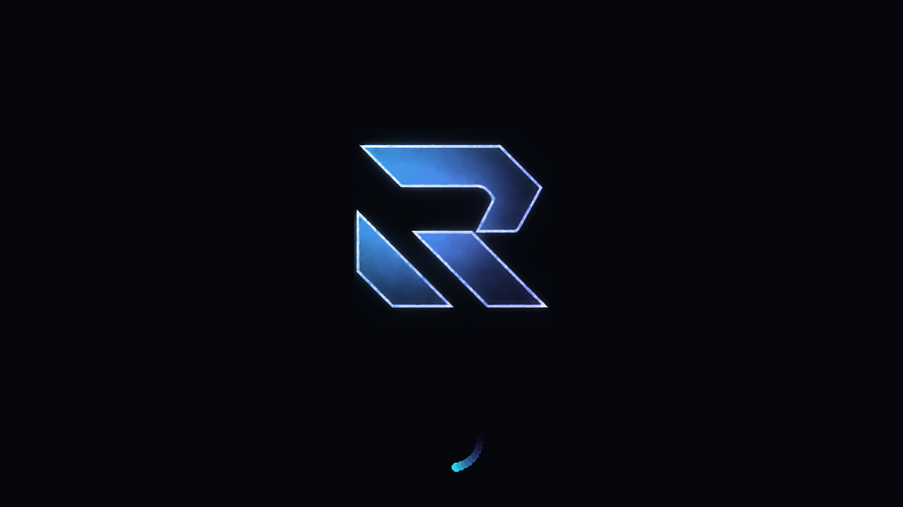

# Razef OS

A custom operating system built on **[Bazzite](https://github.com/ublue-os/bazzite)** — the
gaming-focused Fedora Atomic image — with three things layered on top:

| | What | Where it lives |
|---|---|---|
| 🎨 | **Custom boot experience** — Razef splash, animated spinner, branded GRUB entry, wallpapers, icons | `branding/`, `system_files/overrides/usr/share/plymouth/` |
| 🧭 | **Post-install setup wizard** — first login asks what you want, then configures the machine | `system_files/overrides/usr/bin/razef-firstboot` |
| 🤖 | **Built-in AI assistant** — local, offline, and it can actually inspect the machine | `system_files/overrides/usr/bin/razef-assist`, `.../usr/lib/razef/assist/` |



---

## What you are actually getting

Razef is **not** a fork of Bazzite. Bazzite is an *atomic* (immutable) OS: the root
filesystem is a signed container image, and every custom OS built on it is a
container image that starts `FROM ghcr.io/ublue-os/bazzite-gnome:stable` and adds
its own layer. That is exactly what `Containerfile` does here.

This means:

* **Updates keep working.** When Bazzite ships a new image, Razef rebuilds on top
  of it automatically (the CI runs daily) and your users get normal atomic updates.
* **Nothing is patched by hand.** Every change is a file in this repo, so the
  whole OS is reproducible and reviewable.
* **Rollback is free.** Every update keeps the previous deployment on disk.

Base: `ghcr.io/ublue-os/bazzite-gnome:stable` (Fedora 44, GNOME, Wayland).
An NVIDIA variant (`razef-os-nvidia`) is built from
`ghcr.io/ublue-os/bazzite-gnome-nvidia-open:stable` by the same workflow.

---

## Repository layout

```
.
├── Containerfile              # the whole OS build: FROM bazzite-gnome + our layer
├── image-template.env         # image name, vendor, tags
├── Justfile                   # build / rechunk / vm / lint recipes
├── build_files/
│   └── build.sh               # the actual build steps (packages, branding, initramfs)
├── branding/
│   ├── master/                # source art: logo.png, wallpaper.png
│   ├── build-assets.py        # generates every sized/format asset from master/
│   └── assets/                # generated: logos, splash, 36 spinner frames, wallpapers
├── system_files/overrides/    # files copied verbatim into the image (paths mirror /)
│   ├── etc/                   # ollama.service, autostart, dconf defaults
│   └── usr/
│       ├── bin/razef-assist          # AI assistant launcher (GTK4/WebKit)
│       ├── bin/razef-firstboot       # setup wizard (GTK4/libadwaita)
│       ├── lib/razef/assist/         # backend server + single-file UI
│       ├── share/plymouth/themes/razef/
│       └── share/ublue-os/just/60-razef.just   # ujust recipes
├── disk_config/               # bootc-image-builder configs (VM disk / ISO)
├── iso/flatpaks              # apps baked into the live ISO
├── .github/workflows/
│   ├── build.yml              # lint → build → rechunk → push → sign
│   └── build-iso.yml          # live installer ISO (titanoboa)
└── docs/                      # INSTALL, CUSTOMIZING, AI-ASSISTANT, TROUBLESHOOTING
```

---

## Quick start

### 1. Put this in your own GitHub repo

```bash
git init && git add -A && git commit -m "Razef OS"
gh repo create razef-os --public --source=. --push     # or create it in the UI
```

### 2. Let Actions build it

Push to `main`. The workflow runs:

```
just check → compile python → shellcheck → podman build → rechunk → push to ghcr.io/<you>/razef-os
```

The first build takes ~35–60 minutes (it pulls a ~4 GB base image). It then
rebuilds daily at 10:05 UTC so upstream Bazzite fixes flow in.

Make the package public afterwards: **GitHub → your profile → Packages →
razef-os → Package settings → Change visibility → Public**. (Anonymous
installs need this.)

### 3. Install it

**From an existing Bazzite / Fedora Atomic machine (no reinstall, keeps files):**

```bash
sudo bootc switch ghcr.io/<your-username>/razef-os:stable
sudo systemctl reboot
```

<details>
<summary>Older rpm-ostree systems</summary>

```bash
sudo rpm-ostree rebase ostree-image-signed:docker://ghcr.io/<your-username>/razef-os:stable
sudo systemctl reboot
```
</details>

**On NVIDIA hardware:** switch to `razef-os-nvidia` instead. Don't mix — the
NVIDIA image carries the driver.

**Clean install on a new machine:**

1. Grab an ISO: **Actions → “Build Razef OS installer ISO” → Run workflow**, then
   download the artifact (or `just build-iso` locally).
2. Write it to a USB stick: `sudo dd if=razef-stable-live-amd64.iso of=/dev/sdX bs=4M status=progress oflag=sync`
3. Boot it, install, reboot.

Full details and rollback instructions: **[docs/INSTALL.md](docs/INSTALL.md)**

### 4. First login

The **Razef Setup** wizard opens automatically. It will:

* detect your RAM/GPU and recommend a local AI model
* install Flathub + the apps you tick
* enable the local AI engine and download the model
* apply the Razef look (dark theme, wallpaper, dock)
* brand the GRUB entry

Anything you skip can be re-run later with `ujust razef-setup`.

---

## The AI assistant

`Razef Assistant` is in the app grid and in the dock. It is **fully local**:
a bundled [Ollama](https://ollama.com) instance runs on `127.0.0.1:11434` and a
stdlib-only Python service (`razef-assist`) serves a WebKit UI. No account, no
API key, no telemetry, works with the network cable unplugged.

The part that makes it more than a chat box: it can **read the real machine**.
When a question needs live data, the model asks for one of twelve read-only
diagnostics (GPU/driver state, failed units, journal errors, controllers, disk,
audio, Flatpaks, the gaming stack…) and the answer is written from the actual
output.

```bash
ujust razef-ai            # open it
ujust razef-ai-models     # pull a different model
ujust razef-ai-status     # is the engine up? which models?
```

Model sizing (the wizard picks automatically):

| RAM / VRAM available | Model | Notes |
|---|---|---|
| < 6 GB | `qwen3:1.7b` | fast, runs on anything |
| 6–14 GB | `qwen3:4b` | **default** — good balance |
| 14 GB+ | `qwen3:8b` | noticeably better reasoning |
| 24 GB+ | `gpt-oss:20b` | best local quality, slower |

Details, the exact tool allowlist, and how to point it at a cloud API instead:
**[docs/AI-ASSISTANT.md](docs/AI-ASSISTANT.md)**

---

## Making it yours

**Change the name** (boot logo, About screen, installer, wizard, assistant):

```bash
./scripts/rename.sh "Nova OS" nova
```

**Change the artwork**: drop your own `logo.png` (bright mark on pure black) and
`wallpaper.png` into `branding/master/`, then:

```bash
just brand        # regenerates every logo size, splash, 36 spinner frames, wallpapers
git commit -am "new art"
```

**Change colours**: edit `CYAN` / `VIOLET` at the top of `branding/build-assets.py`
and the `--cyan` / `--violet` variables at the top of the assistant UI.

**Add packages, Flatpaks, settings**: **[docs/CUSTOMIZING.md](docs/CUSTOMIZING.md)**

---

## Everyday commands

```bash
ujust razef-ai              # open the assistant
ujust razef-setup           # re-run the setup wizard
ujust razef-ai-models       # install / switch local models
ujust razef-rebrand-bootloader
just build                  # build the image locally
just build-qcow2            # bootable VM image (test in QEMU)
just build-iso              # installer ISO via bootc-image-builder
just check                  # validate just files
just lint                   # shellcheck
```

---

## Honest limitations

* **This is a derived image, not a distribution.** Kernel, drivers, GNOME and
  gaming plumbing are Bazzite's work. If Bazzite breaks, Razef inherits it.
* **Branding reaches far, not everywhere.** `os-release`, the boot splash, login
  logo, wallpapers, app grid and installer say Razef. Some upstream strings
  remain: the Fedora logo in a few help pages, `fedora` as the package-manager
  ID (kept on purpose — dozens of Fedora tools key off `ID=fedora`), and the
  firmware (BIOS) logo, which no OS can change.
* **The AI assistant is a 4B model.** It is good at "explain this, check that,
  decode this log". It is not a frontier model and it will occasionally be
  wrong. It never runs anything that writes to your system.
* **The ISO workflow is the heavy one.** It needs a `workflow_dispatch` run and
  ~20 GB of runner disk. `bootc switch` is the cheap path.
* **No signing by default.** Add a `SIGNING_SECRET` (cosign key) if you want
  users to be able to enforce signatures.

---

## Credits & licence

* Built on **[Bazzite](https://github.com/ublue-os/bazzite)** and the
  **[Universal Blue](https://github.com/ublue-os)** tooling (`image-template`,
  `titanoboa`, `bootc-image-builder`). All the hard parts are theirs.
* Plymouth two-step integration follows the approach used by
  **[Aurora](https://github.com/ublue-os/aurora)** for initramfs regeneration.
* Razef-specific code (`Containerfile` layer, `razef-firstboot`, `razef-assist`,
  brand pipeline) is Apache-2.0 — see [LICENSE](LICENSE).
* “Bazzite” and the Bazzite logo are the property of the Universal Blue project.
  This repo replaces that branding; if you redistribute a modified image, keep
  the upstream attribution in this README.
